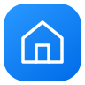
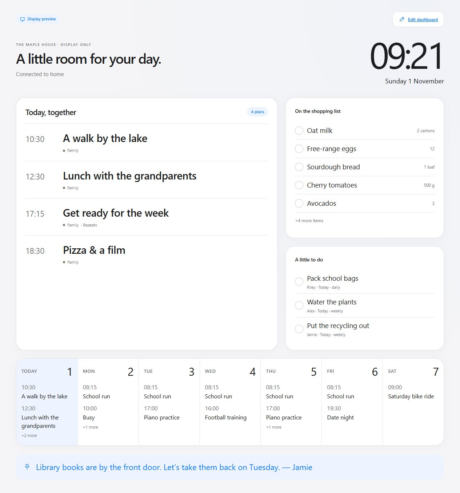
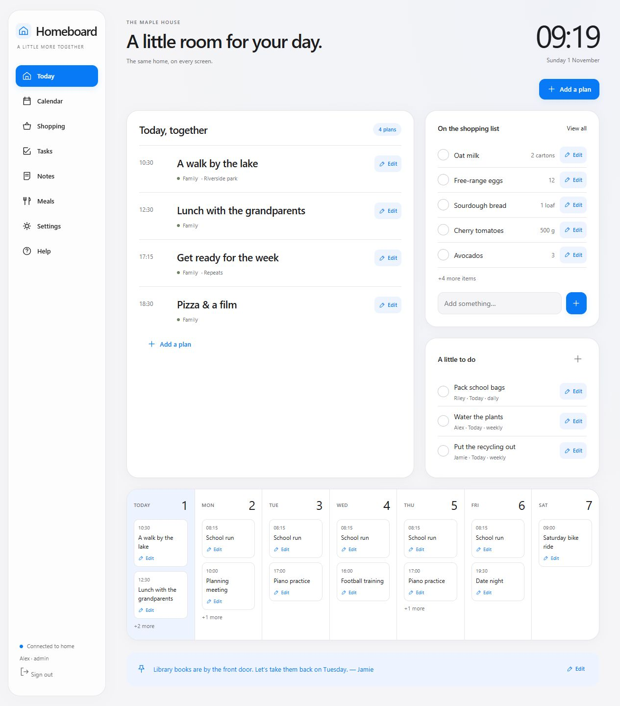
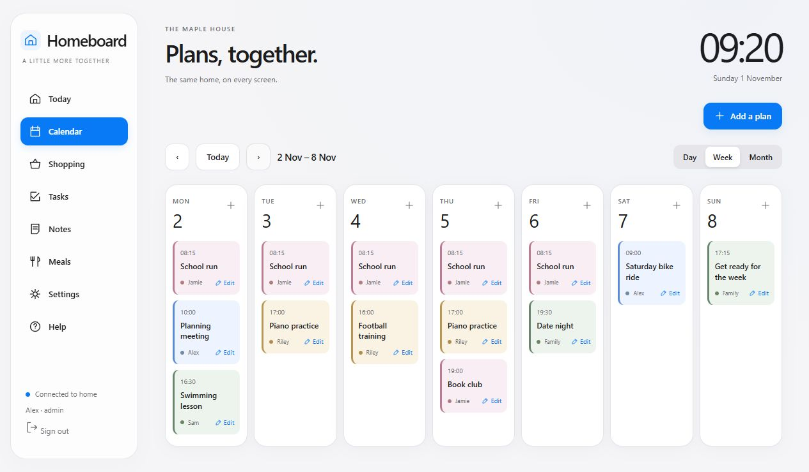
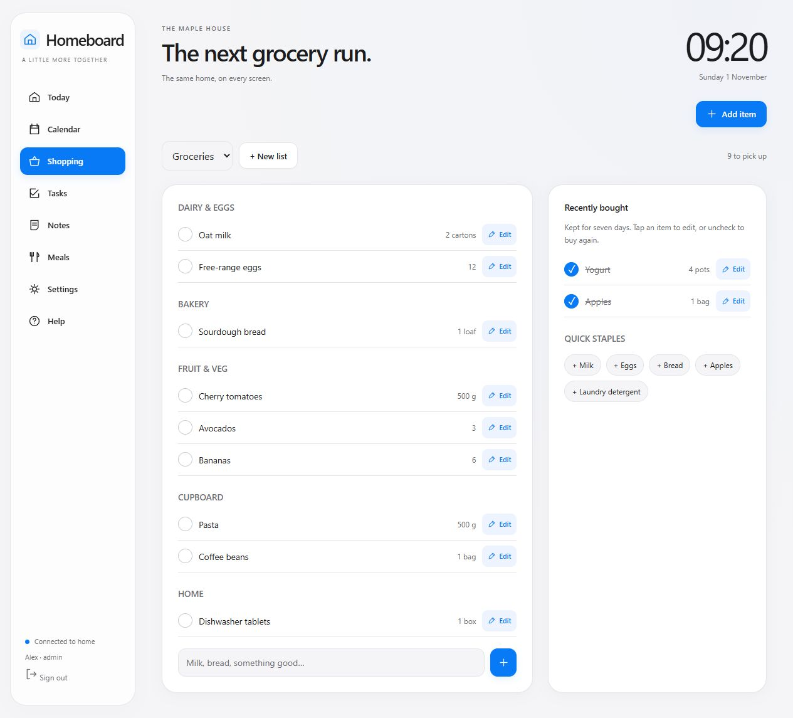
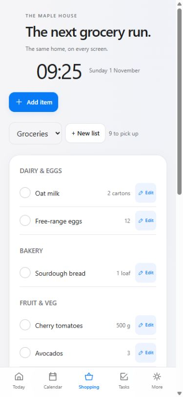
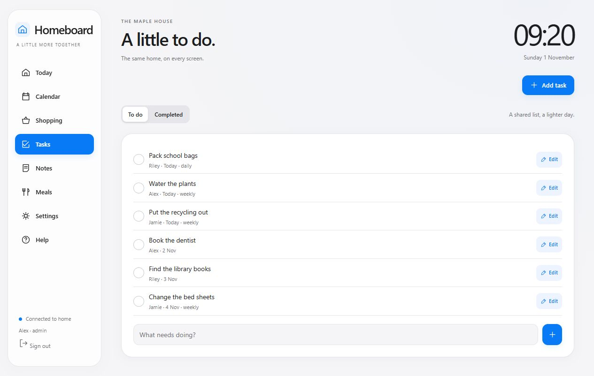
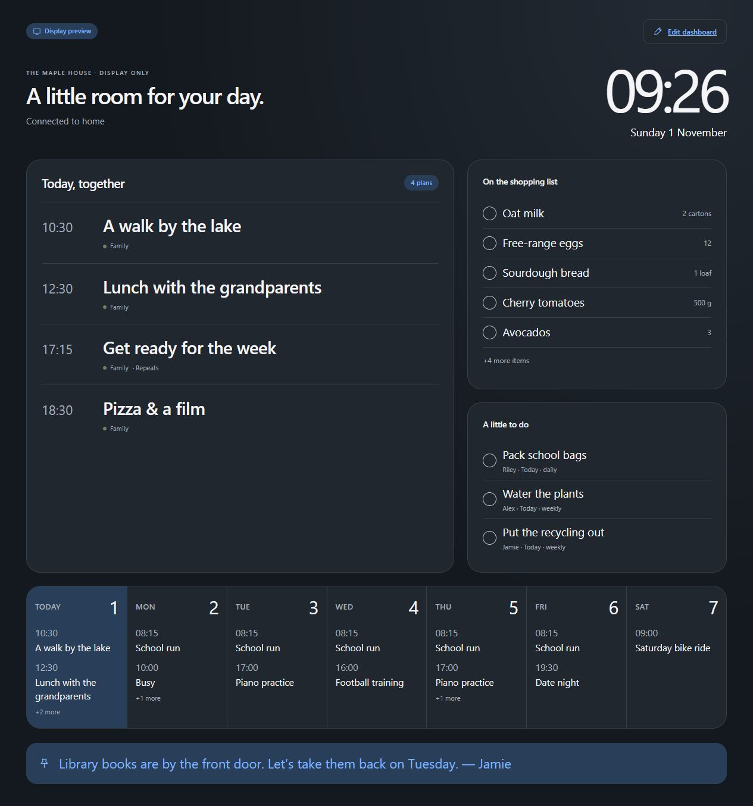
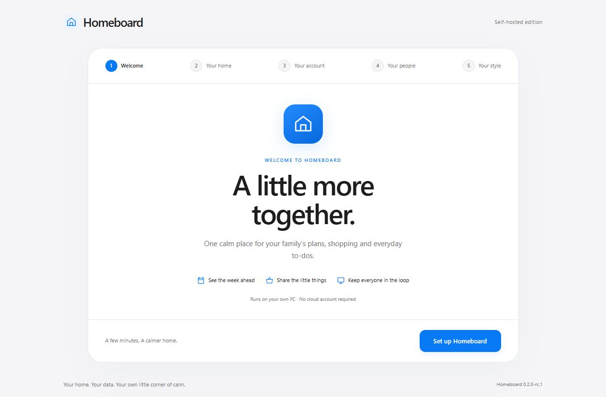

# Homeboard

### A little more together.

Your family’s plans, groceries, chores and dinner ideas. 
One shared home, on the kitchen screen and in everyone’s pocket.

**Free & open source · MIT** &nbsp; · &nbsp; **Windows · macOS · Linux** Self-hosted · Android + iPhone browsers

[Download Homeboard free](https://github.com/owaise-collab/homeboard/releases/tag/v0.3.0-rc.1) · [Set up your home](#your-first-five-minutes) · [Everyday guide](docs/EVERYDAY.md) · [Screenshots](#a-place-for-every-part-of-the-day)

*An ordinary Sunday at the fictional Maple House. Real screens from the app; sample family data.*

## Less “what’s the plan?” More being home.

The school run. The milk you just ran out of. The library books by the door. Homeboard gives the little things a place where everyone can find them.

Leave it open in the kitchen for a quick glance. Add a plan from your phone. Keep a shared list for the next grocery run. Changes appear on your connected devices over your home network.

| A clearer day | A lighter shared load | A home of your own |
| --- | --- | --- |
| A big clock, today’s plans and the week ahead. | Groceries, assigned chores, notes and dinners in one place. | Your own PC hosts the app and stores the household database. |

## A place for every part of the day

### The morning glance

Open **Today** and see what needs your attention: family plans, the shopping shortlist and tasks due today. Each person has a color, and the next seven days sit below the daily view.

### A week everyone can follow

Switch between **Day**, **Week** and **Month**. Add the school run once, select Monday to Friday, and let it repeat. When plans change, the visible **Edit** action lets you update one occurrence or the entire series.

### A grocery list everyone can find

Add “oat milk, 2 cartons” when you notice it’s running low. Open the same list on your phone at home, check what is already in the cupboard, and plan the next shop together. Use categories, separate lists and quick staples; recently bought items stay handy for seven days.

Phone editing requires a connection to the home PC. Using it from the supermarket would require a separately configured secure remote connection; this preview does not provide that connection.

| The full list at home | The same home on a phone |
| --- | --- |
|  |  |

### Small jobs, shared fairly

Assign a task to a family member and give it a due date. Daily and weekly chores can repeat: completing one creates the next scheduled occurrence and keeps the completed one in history.

**And the little extras:** leave a family note, decide what’s for dinner, choose Clear, Warm or Night, and keep sensitive event titles off the kitchen display with **Show only “Busy” on the TV**.

Prefer a darker kitchen screen? Take a look at Night.

## Download it for your computer

Homeboard is free under the [MIT license](LICENSE). No payment, vendor account or activation is required. Download a native preview from the [releases page](https://github.com/owaise-collab/homeboard/releases).

| Host computer | Package | Install |
| --- | --- | --- |
| Windows 10/11 x64 | Setup EXE | Run Setup, then open Homeboard. |
| macOS 15+ Apple Silicon | macos-arm64 DMG | Drag Homeboard into Applications, then open it. |
| macOS 15+ Intel | macos-x64 DMG | Drag Homeboard into Applications, then open it. |
| Linux x64 | linux-x64 tar.gz | Extract, then run `sh install.sh`. |
| Linux arm64 | linux-arm64 tar.gz | Extract, then run `sh install.sh`. |

Linux targets Ubuntu 22.04 or compatible glibc 2.35+ desktops. Native packages are built on each OS and appear together after their checks pass. For other systems, use [Python or Docker](release/README.md#run-from-source-or-docker). Phones and TVs use a modern browser rather than installing the server.

These are unsigned previews. macOS packages are not Apple-notarized, and some computers may block them under their security policies. See [installation details and alternatives](release/README.md).

## Your first five minutes

1. **Install.** Choose your computer’s package from the releases page and follow the installation step above. Open Homeboard on that computer.
2. **Make it yours.** Open Homeboard on that PC. The welcome flow asks for a household name, time zone, owner account, family profiles and starting style. Save the recovery kit when it appears.
3. **Add something real.** A school run, tomorrow’s appointment and a few groceries are a good start. Nothing comes prefilled with someone else’s family data.
4. **Bring your phones.** Open **Help → Connect your devices**. On the same home Wi-Fi, enter the address shown there in your Android or iPhone browser. Create separate adult sign-ins under **Settings → Household access**.
5. **Put it in the kitchen.** Create a **Display** account in Settings, open the same address with `/display` on the TV, and sign in with that account. It has read-only access; adults keep editing from their phones.

**No Python or Docker needed for native desktop packages.** Each package includes its runtime and creates its data folders automatically. Windows Setup offers optional login startup; Linux asks during installation; macOS has an optional login-startup command.

The hosting PC needs to stay **on, signed in and awake**. Your other devices need to be able to reach it on the home network. If Windows asks about network access, use your private home network. See the [connection checklist](release/OPERATIONS.md) if a device cannot connect.

> **Current build: 0.3.0-rc.1, free desktop preview.** Native builds are tested on their target OS. Installers are unsigned; clean-machine, security and device checks remain documented in [release status](#release-status).

## Built for your own home

| You want to… | Homeboard provides |
| --- | --- |
| Keep everyone looking at the same plan | A shared SQLite database, sign-in accounts and live updates between open devices. |
| Use a spare kitchen screen | A dedicated display route, large clock and server-enforced read-only Display accounts. |
| Keep ordinary plans out of the cloud | Local storage and core use over your home network without internet access. |
| Get started without a home-lab project | Native desktop packages with a bundled runtime and guided first use. |
| Keep your household when updating | Data stored separately from application files, automatic database backups and a manual backup action. |
| Recover a forgotten owner password | A saved, single-use recovery code that rotates after use. |

Family **profiles** give calendar entries and chores a name and color. **Sign-in accounts** control access. You can have a profile for a child without giving them a sign-in.

## A few useful answers

**Does everyone need to install an app?** Only the hosting computer. Phones and the kitchen screen use their browsers.

**Can I use a TV’s built-in browser?** Yes, when its browser engine supports the app. TV compatibility varies; if yours is too old, a small HDMI browser player is an alternative. Test your actual TV during the preview.

**Does it work without internet?** Core household features work while devices can reach the hosting PC on the local network. This edition does not save edits made while a device is disconnected.

**Will it remind me when the browser is closed?** Reminders are shown while the page is open. Background push notifications are not included.

**Can I use it away from home or connect Google/Apple Calendar?** Remote access and external calendar synchronization are not included in this preview. Do not forward the app’s port directly to the internet. See [networking and HTTPS](release/OPERATIONS.md).

**Where does my data live?** In a separate per-user folder: `%LOCALAPPDATA%\Homeboard` on Windows, `~/Library/Application Support/Homeboard` on macOS, or `$XDG_DATA_HOME/homeboard` (normally `~/.local/share/homeboard`) on Linux. See [data and uninstall](release/README.md#your-data).

## Go a little deeper

| For your family | For building and maintaining Homeboard |
| --- | --- |
| [Everyday walkthrough](docs/EVERYDAY.md) | [Windows build instructions](release/BUILDING.md) |
| [Installation guide](release/README.md) | [Backup, restore and update operations](release/OPERATIONS.md) |
| [Printable quick start](release/Quickstart.txt) | [Changes in this version](CHANGELOG.md) |
| [Connection and recovery help](release/OPERATIONS.md) | [Third-party notices](THIRD_PARTY_NOTICES.md) |

The interface is one self-contained HTML file with no CDN dependency. The server uses Python and SQLite. Desktop packages bundle the runtime using PyInstaller. Windows uses NSIS Setup, macOS uses a DMG application, and Linux has a per-user installer. Docker Compose is also provided for experienced self-hosters; its safe starting configuration binds to loopback.

The [Windows workflow](.github/workflows/windows.yml) runs checks on pushes and pull requests. Maintainers can run **Actions → Build all desktop downloads → Run workflow** to build, smoke-test and publish all five native packages together. Public standard GitHub-hosted runners build them without a paid runner service. [Source packaging](scripts/package_release.py) uses an explicit allowlist and SHA-256 manifest to exclude household data and personal deployment files.

## Release status

Homeboard is free and open source under [MIT](LICENSE), including commercial reuse with the license notice retained. There is no paid activation or mandatory cloud service.

This is a community preview, not a certified production appliance. Automated checks cover the server, permissions, recurrence, onboarding and desktop lifecycle. Native release jobs test their actual frozen executable for first use, recovery-code creation, backup, duplicate launch and restart.

Trusted publisher signing/notarization, full clean-machine installation/upgrade/uninstall tests, independent security review and broader TV/distribution testing remain in the [release checklist](release/SELLER-CHECKLIST.md). Do not expose its app port directly to the internet. Dependency licenses remain separate in [third-party notices](THIRD_PARTY_NOTICES.md).

 
<strong>Your home. Your data. A little more together.</strong>

