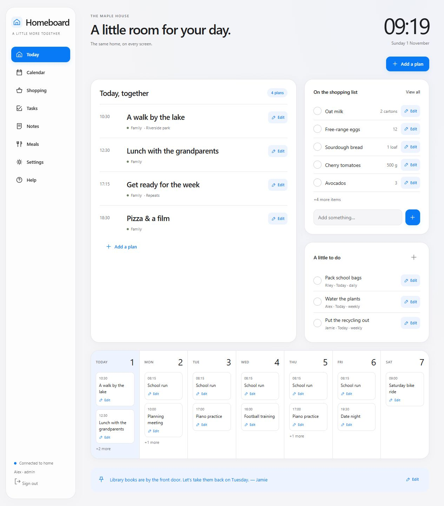
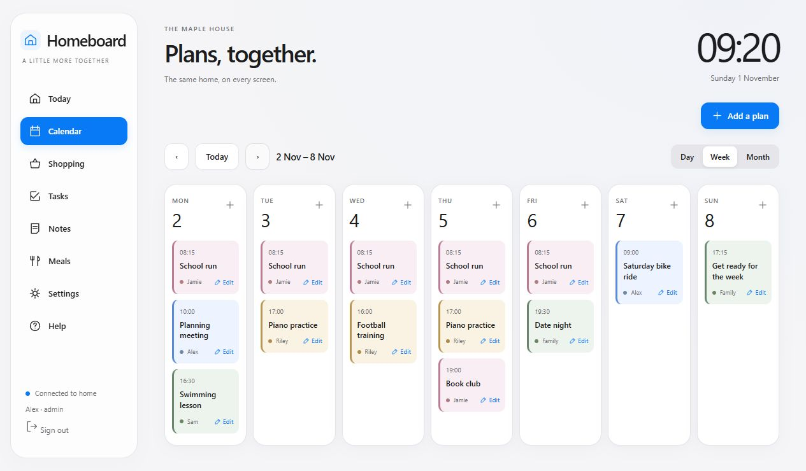
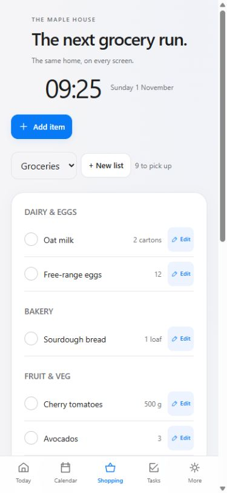
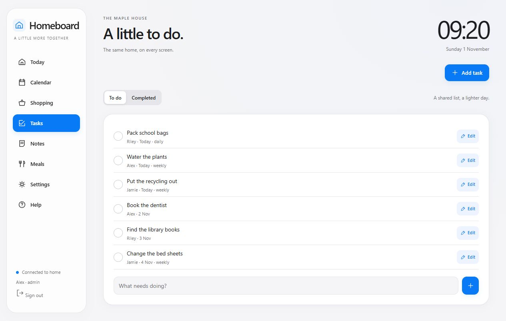
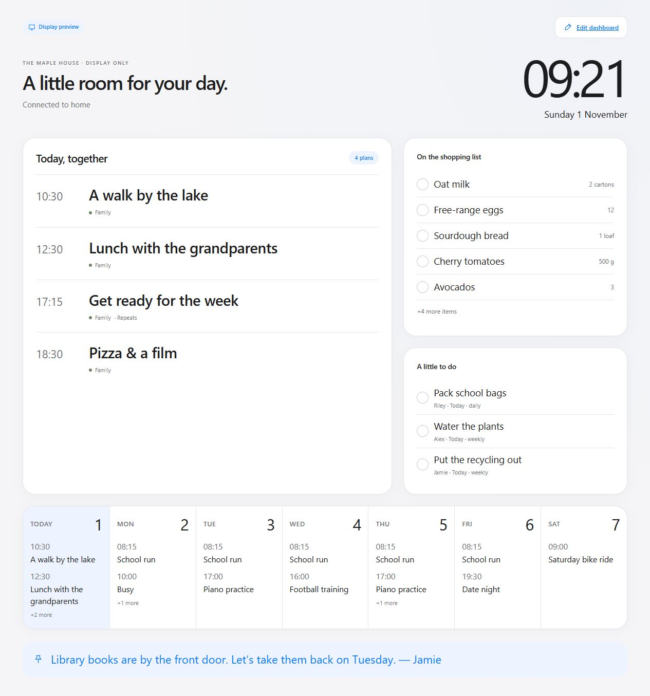
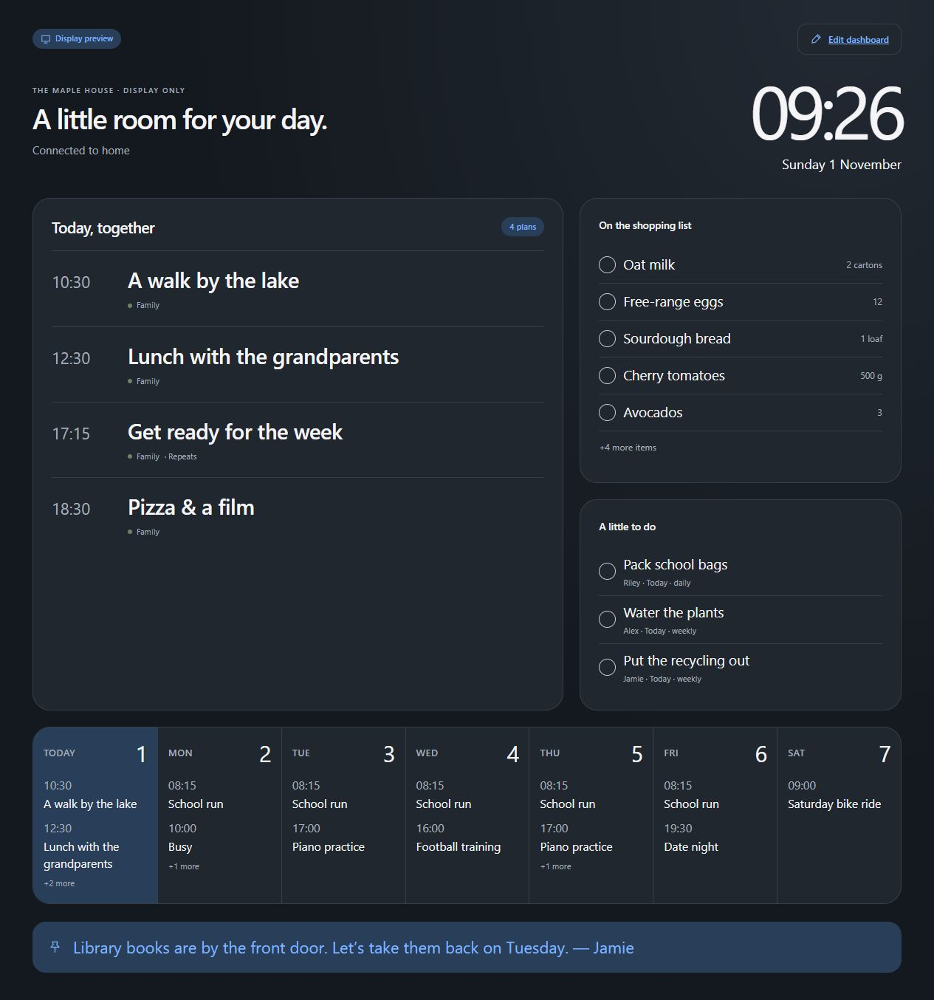

# A day with Homeboard

Start with the plans your family asks about most often. Add the little things as they come up. You do not need to fill every section on day one.

[Back to Homeboard](../README.md) · [Installation](../release/README.md) · [Backups and troubleshooting](../release/OPERATIONS.md)

## Morning: a glance before everyone heads out

Open **Today** on your phone or leave the kitchen screen on **Display**. The clock, today's plans, due tasks and shopping shortlist put the essentials together. The strip below shows the next seven days.

If the kitchen screen shows a plan as **Busy**, its title has been hidden for display accounts. Open the normal dashboard with an adult account to see and edit it.

## Sunday planning: put the regular things in once

Try a school run:

1. Open **Calendar → Add a plan**.
2. Enter **School run**, choose the starting date and set **Starts** to **08:15**.
3. Use **For** to choose the family profile responsible for it.
4. Set **Repeat → Every week** and tick **Mon, Tue, Wed, Thu, Fri**.
5. Add a place or note if useful, then save.

The starting date is the earliest day the event can appear. It repeats on the selected weekdays from then on. An optional end date can stop the series at the end of term.

**A one-off change:** select **Edit** on that day's event. Keep **Apply changes to → This occurrence**, adjust the time or other details, then save.

**A lasting change:** choose **Entire series**. This also reveals the repeat controls so you can change the weekdays. Use the same scope choice when deleting: one occurrence or the whole series.

Use **Day** for detail, **Week** for the family overview, and **Month** when planning further ahead. The arrows move through dates; **Today** brings you back.

## During the day: add it when you notice it

When someone says “we’re nearly out of milk,” open **Shopping** and use the quick-add field. For more detail, select **Add item** and enter a quantity, category and list name.

| Item | Quantity | Category | List |
| --- | --- | --- | --- |
| Oat milk | 2 cartons | Dairy & eggs | Groceries |
| Bananas | 6 | Fruit & veg | Groceries |
| Dishwasher tablets | 1 box | Home | Groceries |

The list selector switches between lists. **+ New list** creates a name you can use when adding items. Quick staples save a little typing for familiar items.

## On your phone: the same shared list

Open the Homeboard address on your phone at home and select **Shopping**. Check the cupboards while someone else adds what is missing. Tap a checkbox to mark an item as bought. The kitchen screen and other connected phones update to reflect the change.

Checked items move to **Recently bought**, where they stay visible for seven days. Uncheck one to put it back on the active list. Use **Edit** to change an item or remove it.

Keep the phone connected to a network that can reach the host PC. Supermarket access would need a separately configured secure remote connection, which this preview does not provide. Edits are not queued while you are away from the home network. If the connection indicator reports a problem, reconnect and refresh before making changes.

## After school: make the small jobs visible

Open **Tasks → Add task**, name the job, choose a due date and assign a family profile under **For**. Set a repeat schedule for jobs that keep coming back.

For example, assign **Pack school bags** to Riley and set it to repeat daily. Checking it off keeps the completed entry in history and creates the next scheduled occurrence. **Completed** shows the history; **To do** shows what is still open.

Profiles are labels for people. Adding Riley as a profile does not automatically create a Riley sign-in.

## Evening: fewer little questions

Use **Meals** to put a simple dinner plan against each of the next seven days. Select **Edit dinner**, type the meal and save. It is a dinner planner; recipe imports and automatic grocery generation are not part of this edition.

Use **Notes → Leave a note** for things like “library books are by the front door.” Notes can have an expiry date. Select **Keep off the TV** for a note that should stay off a shared screen.

## The kitchen screen: everyone can see, adults can edit

1. From the owner account, open **Settings → Household access → Add account**.
2. Create a separate account and select **TV · read only** for its access.
3. On the TV browser, open the home address shown in **Help → Connect your devices**, followed by `/display`.
4. Sign in using that Display account. Keep adult sign-ins on personal devices.

The display is designed for glancing across the room: a large clock, today's agenda, shopping and due tasks. It has no editing controls for a Display account. Event titles marked **Show only “Busy” on the TV** appear as Busy, and notes marked private are omitted.

Some built-in TV browsers are too old for modern web apps. Test your TV; a current browser on an HDMI-connected player is an alternative. Keep the host PC awake and signed into Windows so it can serve the dashboard.

## Make it feel like your home

In **Settings**, change the household name, time zone, 12/24-hour clock and theme. **Clear** is the crisp light style shown above; **Warm** uses softer tones; **Night** is a darker option. Family profiles can have their own colors.

## Once in a while: give your data a second home

Use **Settings → Back up now** to create a fresh database backup on the hosting PC. Automatic backups are also stored there. Copy backups to a separate drive; a backup on the same disk cannot protect against that disk failing.

**Export backup** downloads household records as JSON. It does not include the full account/session database. For a full restore or moving computers, follow the [operations guide](../release/OPERATIONS.md).

Keep the recovery kit from first use somewhere private. If the owner password is forgotten, **Recover access** on the sign-in screen uses its single-use code, resets the password and issues a replacement code. If you can still sign in, **Settings → Recovery kit** creates a replacement after confirming the current owner password.

## When a screen does not update

Check that the PC is on, awake and connected; check that the phone or TV is on the same reachable home network. A guest Wi-Fi network may isolate devices. Open Homeboard from its Windows shortcut and use the address shown in Help rather than guessing the PC's address or port.

If Windows asks about network access, use the private home network. Do not turn off the firewall or expose the app port to the internet. See [connection, HTTPS and recovery steps](../release/OPERATIONS.md) for the current preview setup boundary.
